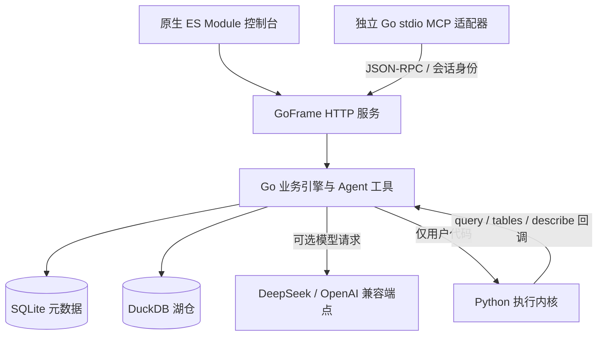

# 架构说明

## 服务结构

v0.4 使用 GoFrame v2.10.4 作为唯一 HTTP 服务。业务引擎、鉴权、SQLite、DuckDB、Agent 工具循环、调度和 MCP 工具执行均为 Go；Python 仅执行用户的 Notebook / Python 节点代码。

MCP 适配器不直接打开湖仓，避免与 HTTP 服务争用 DuckDB 的进程锁。鉴权和工具执行统一在 GoFrame 进程内完成。

## 代码分工

| 文件 | 职责 |
| --- | --- |
| `cmd/opendatabuddy/main.go` | 环境与参数、HTTP 启停、调度生命周期、stdio 适配器 |
| `internal/platform/server.go` | GoFrame 路由、请求上下文、鉴权入口、错误响应与审计 |
| `store.go` / `config.go` | SQLite 存储、增量迁移、DuckDB 初始化、环境文件 |
| `auth.go` | PBKDF2 密码、可撤销会话、用户和空间权限 |
| `sql.go` / `data.go` / `ingest.go` | SQL 分词与只读护栏、空间表白名单、目录、文件接入、卷 |
| `agent.go` / `heuristic.go` / `mcp.go` | 模型工具循环、暂停和恢复、规则兜底、知识检索、MCP |
| `workflow.go` / `expression.go` / `operations.go` | DAG、条件表达式、重试、时区调度、报告/Buddy 任务、告警 |
| `bundle.go` | YAML、声明校验、幂等发布、归属记录与销毁 |
| `quality.go` / `drift.go` | 规则、阻断、统计剖析、基线、漂移与异常 |
| `features.go` / `mlops.go` | 特征版本/物化/训练集、模型版本、冠军与服务流量 |
| `analysis.go` | 指标 SQL、问数、归因、报告、看板与嵌出配置 |
| `governance.go` / `lineage.go` | 敏感规则、安全检查、运维视图、血缘发现和双视图 |
| `resources.go` | 资源 CRUD 的共用存储与字段适配 |
| `python.go` / `scripts/python_kernel.py` | 内核进程管理、超时、cell 状态与 JSON-lines 回调协议 |

## 数据与兼容

SQLite 继续使用旧版表结构；启动时先建缺失表，再按 `assets/migrations.json` 补列，最后建立索引。测试覆盖旧列缺失后的恢复、身份保持和重启不重复灌数。

旧目录的逻辑名 `demo.retail.fact_orders` 仍映射到 `"demo__retail"."fact_orders"`。新建目录记录独立 `physical_prefix`，不同工作空间可以拥有相同的逻辑目录与表名。

SQL 先分词，再验证只读语句、外部文件/系统函数及当前空间允许的关系引用。字符串不参与标识符重写。查询受行数与时间上限约束。SQLite 与 DuckDB 各使用一个数据库连接；这是单机部署方案。

保留 v0.3 的 220 条路径、280 个 HTTP 操作；契约快照在 `assets/openapi.json`。旧扩展模块不再动态导入或静默降级，全部 Go 代码必须通过编译。前端仍使用按需模块加载。

## 执行与恢复

DAG 先拓扑排序并检测环。节点记录落入 `flow_node_runs`；失败可按配置重试。审批时保存工作流定义、参数、已完成节点与输出；批准后继续同一运行记录，不重放已完成节点。

Buddy 使用相同方式保存模型消息序列与待执行工具队列。恢复审批时，已经完成的工具不会再次执行。工具记录写入 `traces`，HTTP 变更和重要业务操作写入审计表。

调度器每 20 秒检查工作流、报告和 Buddy 定时任务。cron 为五段数值语法，支持列表、范围、步长；按任务时区运行，默认 Asia/Shanghai。持久化时间戳防止同一分钟重复触发；持续工作流最小间隔 60 秒。

## Python 边界

控制台及非 Python 业务无需 Python。执行内核仅通过标准输入输出收发代码、参数、结果和回调；它不导入后端业务模块，也不直接连接 SQLite / DuckDB。`query()` 回到 Go 的查询与空间权限链路。每个 Notebook 保持独立变量状态；超时会终止并重置进程。

内核不是操作系统沙箱，变量不跨服务重启保存，也不提供多机器共享。具体边界及验证命令见根目录 README 和 HANDOFF。
